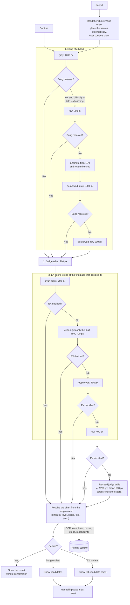

# BPIM2 Camera

A PWA that reads the result screen of beatmania IIDX from a phone camera (or an imported image), identifies the song and chart, reads the EX score, and shows the BPI. Scores can be registered to [BPIM2](https://bpi2.poyashi.me), and the result can be shared to X as an image.

- App: https://bpi-cam.poyashi.me
- Requirements: [docs/requirements.md](docs/requirements.md) (Japanese)
- License: [AGPL-3.0](LICENSE)

All recognition runs on the device (WebAssembly in Web Workers). The network is used only for the song master, the BPI calculation / ranking API, sign-in, BPIM2 sync, and the optional training-data upload.

## Features

- **Camera capture** with white guide frames (score, song-title band, judge table). Frames can be adjusted in setup, in Settings, or directly on the camera view (drag to move, drag a corner to resize).
- **Auto capture** (experimental): shoots when the screen is steady. Uses the tiny OCR model for a quick preview; the shutter button always uses the small model.
- **Camera selection** with a live preview in setup and Settings.
- **Result drawer**: song / chart, EX score, BPI, estimated rank, BPI chart, history for the chart. Every value can be corrected by hand.
- **History** stored on the device (image and result).
- **BPIM2 sync** (sign-in required: Google / X / LINE / email) to the latest version or INFINITAS.
- **Share to X** as the photo or a card, with a customizable text template. Optional save to the camera roll.
- **Cancel handling**: if OCR is cancelled while auto-save is on, a dialog asks whether to save only the image.
- **Debug mode** (Settings): shows the OCR result JSON at the bottom of Settings.
- **Open-source licenses** are listed (collapsed) in Settings.

BPI is calculated only for ☆11 and ☆12. Lower levels are still read, stored, and shared; the BPI is shown as "not applicable".

## Commands

```
pnpm install
pnpm models:fetch   # download the PaddleOCR models into public/models/paddle (not in git)
pnpm dev            # dev server
pnpm build          # type-check and build
pnpm preview        # serve the build
pnpm test           # unit tests (vitest)
pnpm typecheck
pnpm eval           # evaluation on real images (separate vitest config; see below)
pnpm train:digits   # rebuild public/models/digits.json from training/manifest.json
pnpm licenses:gen   # regenerate src/generated/licenses.json
node scripts/make-icons.mjs   # regenerate the PWA icons
```

`pnpm eval <filter>` runs the scripts in `test/eval`. They read private sample images (`SAMPLE_DIR`, default `D:/camera-example`) and write results to `internal/*.txt`, because console output is suppressed.

## Environment variables

Set in `.env.local` (see `.env.example`). They are read at build time, so the production build needs the same variables.

| Name | Purpose |
| --- | --- |
| `VITE_STATS_UPLOAD_ENDPOINT` | URL of the upload Worker's `/v1/upload-urls`. If empty, nothing is uploaded. Production: `https://bpim2-camera-upload.poyas.workers.dev/v1/upload-urls` |
| `VITE_TURNSTILE_SITE_KEY` | Turnstile site key for email sign-in (same value as BPIM2's `NEXT_PUBLIC_TURNSTILE_SITE_KEY`) |

## How a result is read

The camera path crops three regions with the guide frames and reads them with PaddleOCR (PP-OCRv6 via `ppu-paddle-ocr` / onnxruntime-web). It runs on the GPU (WebGPU) when the device has it, otherwise on the CPU (multi-threaded WASM), where the title and the score/judge regions are read in two workers at the same time. Importing an image goes through the same path: the app first reads the whole image once, finds fixed labels (judge labels, "SCORE", difficulty, "NOTES", the song title, …), fits them to a reference photo with a similarity transform, and places the three frames; the user corrects them and confirms, and the crops are read like a camera capture.

1. **Score**: the cyan digits are extracted by color, then read by several preprocessing passes; the EX score is decided when independent readings agree (consensus engine). The judge table (PGREAT / GREAT / ...) is used as a cross-check, which also catches one-digit errors.
2. **Song-title band**: reads difficulty, level, and note count to narrow the song master, then matches the title, artist, and genre by edit distance. Reading passes: grayscale 1200 px, then the raw image at 900 px.
3. **Tilt correction (fallback)**: if the song is still unresolved, the tilt of the title lines is estimated (projection profile, ±15°), the crop is rotated, and it is read again. It is used only as a fallback.
4. If everything is certain, the result is shown without confirmation. Otherwise candidates are shown, then EX score chips, and manual input only as a last resort.

The OCR trace (which pass produced what) is kept with each training sample and shown in debug mode.

Models: `public/models/paddle` (small ≈ 31 MB as `.onnx` so WebGPU can load it, tiny ≈ 6 MB as `.ort`; fetched by `pnpm models:fetch`, served from the app so it works offline). `public/models/digits.json` (a small nearest-neighbor digit classifier) is only used by the evaluation scripts. The app downloads and caches the models and the onnxruntime-web runtime itself (Cache Storage `bpim2-ocr-assets-v1`, with a download progress toast); the CPU workers use the WASM-only runtime (≈ 15 MB) and the GPU worker the WebGPU runtime (≈ 29 MB), so only the one in use is fetched. Unused files can be deleted in Settings.

### Flow



How EX is decided: the score and the judge table are read independently and a consensus engine accepts a value only when the readings agree and do not contradict the judge counts (PGREAT × 2 + GREAT). After every pass the app records whether the song and EX are already known (`steps` / `resolvedAt` in the OCR trace), so the stage that decided each result can be inspected afterwards.

## Song master

Loaded from BPIM2 `GET /api/v2/songs/master` at startup and cached. If the request fails (or before it is available), the bundled seed `public/data/songs-master.json` is used.

## Training data

Opt-in. When the user agrees to statistics, every read is stored on the device as soon as OCR finishes, whether it succeeded or failed (no confirmation needed): the cropped images (score, title, and judge regions, plus the USE OPTION and MISS COUNT areas when they are in the photo), the full photo, and the OCR trace. The full photo is redrawn as a JPEG (longest side up to 1920px, so EXIF such as location is dropped) and is used to train readers whose crop position is not settled yet, such as TIMING STATUS (FAST/SLOW). It is removed from the device once uploaded, and it is not included in the zip export. Confirming adds the values the user entered or picked (use option, miss count) to the label; these are the ground truth for teaching the app to read them. The use option falls back to `OFF` when it cannot be read, because the screen shows no USE OPTION line when no option is used. If "include images" is off, only `labels.json` is uploaded (the crops stay on the device); turning it on later uploads the images for samples that were sent without them. If the user later confirms the result, the confirmed values are added as the ground-truth label (`confirmed: true`) and the sample is uploaded again, overwriting the earlier one. Samples that were never confirmed have `confirmed: false` and null label fields. Cancelled reads are not collected; imported images are collected like camera reads (crops only). "Export" in Settings makes a zip (`labels.json` and images).

Upload (`src/lib/training/upload.ts`): when consent is given and `VITE_STATS_UPLOAD_ENDPOINT` is set, unsent samples are uploaded oldest first when a read finishes, on confirmation, on app start / setting change, and when the device comes back online. Failures stay in the queue and are retried. Samples are written to R2 as:

```
samples/<deviceId>/<sampleId>/{score.jpg, title.jpg, judge.jpg, useOption.jpg, missCount.jpg, full.jpg, labels.json}
```

`labels.json` includes the OCR trace (`ocr`): every line read, as `text(confidence)[x,y,w,h]` where the box is a 0–1 ratio of the image that was read (the crop; for deskewed title passes, the rotated image); `steps`, one entry per OCR pass (`title:gray1200`, `title:raw900`, `title:deskew:gray1200`, `title:deskew:raw900`, `judge:<width>`, `score:<mask><width>`) with the line count, elapsed ms, and the song / EX known after that pass; and `resolvedAt`, the first pass at which the song and the EX score were determined.

### Upload Worker (`worker/`)

A Cloudflare Worker that issues presigned R2 PUT URLs (hand-written SigV4 query signing with WebCrypto, `UNSIGNED-PAYLOAD`). The client sends `deviceId`, `id`, and the file names/sizes, then PUTs each file straight to R2. It validates IDs (`^[A-Za-z0-9_-]{8,64}$`), file names, and sizes (images ≤ 512 KB, labels ≤ 16 KB), and answers CORS only for allowed origins. There is no rate limit or authentication on URL issuance.

Deploy:

```
cd worker
# variables in wrangler.jsonc: R2_BUCKET, ALLOWED_ORIGINS (comma-separated origins)
npx wrangler secret put R2_ACCOUNT_ID
npx wrangler secret put R2_ACCESS_KEY_ID
npx wrangler secret put R2_SECRET_ACCESS_KEY
npx wrangler deploy
```

The R2 bucket also needs a CORS rule that allows `PUT` with the `content-type` header from the same origins as `ALLOWED_ORIGINS`:

```
npx wrangler r2 bucket cors set <bucket> --file cors.json
```

Current deployment: Worker `bpim2-camera-upload`, bucket `bpim2cam`, allowed origins `https://bpi-cam.poyashi.me` and `http://localhost:5173`.

## Sign-in (Firebase)

`authDomain` is the app's own host, and `/__/auth/*` is proxied to `bpimv2.firebaseapp.com`. With a different domain, the browser's storage partitioning prevents the redirect result from being received. The Vite dev/preview server proxies it (it also works over Tailscale).

For each domain you use (test: `*.ts.net`, production: the app URL):

1. Firebase console > Authentication > Settings > Authorized domains: add the domain.
2. Add `https://<domain>/__/auth/handler` to each provider's redirect (callback) URI:
   - Google: Google Cloud console > Credentials > the OAuth client for Firebase > Authorized redirect URIs
   - X: Callback URI in the developer portal
   - LINE: Callback URL of the LINE Login channel
3. Email sign-in (with Turnstile) uses BPIM2's confirmation-mail API; the Turnstile token is verified by the BPIM2 server.
   - Set `VITE_TURNSTILE_SITE_KEY`.
   - Add the app's domain to the allowed hostnames of the Turnstile widget.
   - Add the app's origin (for example `https://camera.example.com`) to BPIM2's `EMAIL_LINK_ALLOWED_ORIGINS`. The link in the email may only return to `/signin.html` of a listed origin.
4. Production VPS (nginx example). Do not send COOP/COEP on `/__/auth/` or `/signin.html`.

```nginx
location /__/auth/ {
    proxy_pass https://bpimv2.firebaseapp.com;
    proxy_ssl_server_name on;
    proxy_set_header Host bpimv2.firebaseapp.com;
}
location /bpim2-api/ {
    # Authenticated BPIM2 API (user name, icon, ...). No CORS, so it is proxied same-origin.
    proxy_pass https://bpi2.poyashi.me/;
    proxy_ssl_server_name on;
    proxy_set_header Host bpi2.poyashi.me;
    # so that BPIM2's rate limit and Turnstile verification see the user's IP
    proxy_set_header X-Forwarded-For $remote_addr;
}
location = /signin.html {
    # no Cross-Origin-Opener-Policy / Cross-Origin-Embedder-Policy
}
location / {
    add_header Cross-Origin-Opener-Policy same-origin;
    add_header Cross-Origin-Embedder-Policy require-corp;
}
```

COOP/COEP are required for the multi-threaded WASM (the CPU path on devices without WebGPU). The Service Worker does not serve the app shell for navigations to `/__/auth/`.

## Testing on a phone (Tailscale)

The camera requires HTTPS, so use `tailscale serve`. If 443 is taken by another app, use 8443.

```
pnpm dev
tailscale serve --bg --https=8443 5183
# open https://<device>.<tailnet>.ts.net:8443 on the phone (same tailnet)
tailscale serve --https=8443 off   # stop publishing
```

## Stack

Vite, React 19, TypeScript, Tailwind CSS v4, shadcn-style UI (Radix, vaul, sonner), idb (IndexedDB), PaddleOCR on onnxruntime-web, Firebase Auth, Google Tag Manager. Path alias: `@/` → `src/`.

## Status

- Real-photo auto-confirm rate has not been measured yet.
- The digit model has few samples (no 0, 2, 8), so it counts as a single vote.
- Title reading can still fail on strongly tilted photos or low-contrast (for example pink) titles; the tilt fallback reduces this.
- The upload endpoint has no rate limit or authentication.
